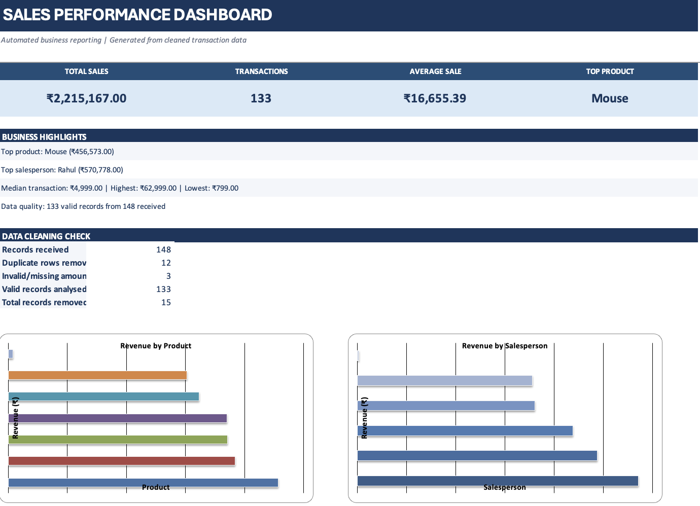

# Automated Business Sales Reporting System

A Python project that cleans messy sales CSV data, analyses sales performance, identifies useful business insights, and automatically creates a formatted Excel report.

## Features

- Validates required CSV columns (`product`, `salesperson`, `amount`)
- Removes duplicate rows
- Cleans rupee symbols, commas, whitespace, and numeric sales amounts
- Handles missing or invalid amounts
- Replaces missing product and salesperson names with `Unknown`
- Standardises product and salesperson names
- Calculates total, average, median, highest, and lowest sale
- Compares revenue and transaction counts by product and salesperson
- Identifies the top-performing product and salesperson
- Creates an Excel dashboard with KPI cards, business highlights, data-cleaning checks, and two charts
- Includes separate product, salesperson, and cleaned-data worksheets

## Tech Stack

- Python
- Pandas
- OpenPyXL

## Setup

```bash
pip install pandas openpyxl
```

## Run

```bash
python main.py sample_sales_messy.csv
```

Or provide a different CSV file:

```bash
python main.py your_sales_file.csv --output your_report.xlsx
```

If no filename is provided, the program prompts for one:

```bash
python main.py
```

The output workbook defaults to `sales_business_report.xlsx`.

## Input format

The CSV must contain these columns:

```csv
product,salesperson,amount
Laptop,Rahul,55000
Mouse,Priya,"₹2,500"
Keyboard,Aman,4000
```

## Cleaning behaviour

- Exact duplicate rows are removed.
- Currency symbols and thousands separators are removed before numeric conversion.
- Amounts that cannot be converted to numbers are excluded from the analysis.
- Missing or blank product and salesperson names are labelled `Unknown`.
- Names are trimmed and converted to title case.

The workbook's Dashboard sheet reports the number of received, duplicate, invalid, valid, and removed records.

## Excel workbook



The generated workbook contains four sheets:

1. **Dashboard** – KPI cards, business highlights, data-quality summary, revenue-by-product chart, and revenue-by-salesperson chart.
2. **Sales by Product** – revenue, average sale, and transaction count for each product.
3. **Sales by Salesperson** – revenue, average sale, and transaction count for each salesperson.
4. **Cleaned Data** – the cleaned records used for analysis.

## Project structure

csv-business-report/
├── .gitignore
├── README.md
├── dashboard.png
├── main.py
├── requirements.txt
├── sales.csv
├── sales_business_report.xlsx
└── sample_sales_messy.csv


## Example workflow

```text
Raw CSV
  -> Column validation
  -> Data cleaning
  -> Sales analysis
  -> Business insights
  -> Excel dashboard and detailed worksheets
```

This project demonstrates how a repetitive sales-reporting workflow can be automated with Python and Excel.
